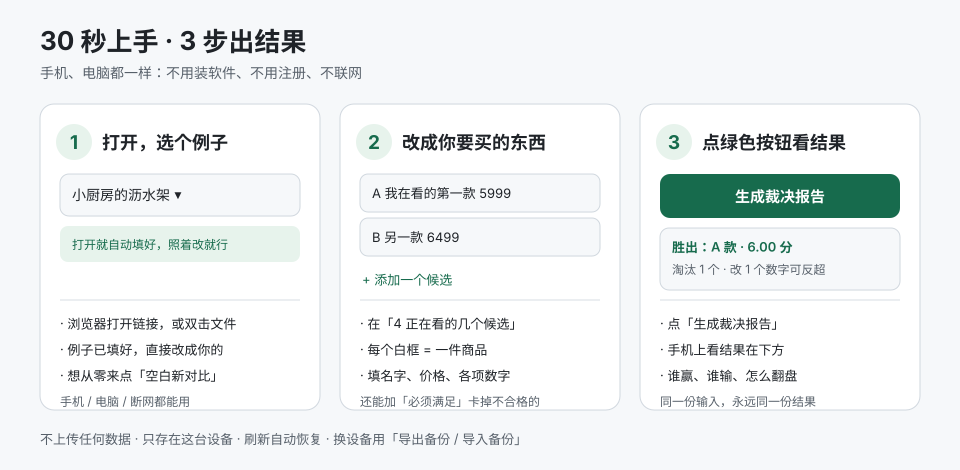

# 一眼看懂 · specpick 怎么用

> **一句话**：把你在看的几个东西、和你在意的条件填进去，它按**你自己写下的标准**告诉你该买哪个，并写清楚「另一个为什么输了」「要改哪个数字它才会赢」。
>
> 不猜你喜欢什么。不用装软件、不用注册、不联网、不用 API Key，手机和电脑都一样。

---

## 先打开它（三选一）

| 你的情况 | 怎么做 |
| --- | --- |
| 手机 / 电脑，有网 | 浏览器打开 **https://cbjinchina.github.io/specpick/**，点开即用，什么都不用装 |
| 没网 / 要发给别人 | 把 **`web/specpick.html`** 这**一个文件**存到手机或电脑，双击打开，完全离线 |
| 想拿截图让模型帮着录参数（进阶） | 电脑上跑 `python playground/server.py 8765`，浏览器开 `http://127.0.0.1:8765` |

打开后**已经有一个填好的例子**（小厨房的沥水架），不用从空白开始，照着改就行。想从零来，点「空白新对比」。

---

## 三步，30 秒

> **不想读字？点页面顶部那个「开始一步步指引」按钮。** 它会自动跳到该点的地方，用**绿框**圈住、标上序号，底部跟一句话说明这一步干什么；点「下一步 →」继续，点「退出」随时结束。手机、电脑都能用。



### 第 1 步：打开就有例子

页面最上面是个下拉框，已经帮你选好一个例子。左边是**要填的内容**，右边（手机上在下方）是**裁决报告**。

### 第 2 步：改成你要买的东西

> **更省事的走法**：手机相册长按截图 →「提取文字」→ 复制 → 粘到页面「**只有文字？粘文字也能填（备用）**」，**一粘就自动识别**（也可以再点「识别并填入」）。名称和价格自动配好，你只需核对几个数字，不用一个个手打。电脑上更直接：截图后在本页面按 **Ctrl+V（⌘V）**，图片会直接交给识图模型。

重点在这里 ——「**4 正在看的几个候选**」就是**填你要对比的物品**的地方：

- **一个白框 = 一件商品**，填名字、价格，以及上面「2 你在意哪些方面」里列的那些数字；
- 商品不够就点「**+ 添加一个候选**」，多了点框右上角的删除；
- 「**1 你要买什么**」改预算和标题；
- 「**2 你在意哪些方面**」拖权重滑块：越在意拖越高，`0` 表示只拿来筛选、不参与打分；
- 「**3 必须满足的条件**」写死规矩，比如「宽度 ≤ 30cm」，不合格的会被直接淘汰并写出原因。

想对比电脑？下拉框里就有「**笔记本电脑 · 通勤办公**」这个现成案例，改成你正在看的两三台就行。

### 第 3 步：点绿色的「生成裁决报告」

右边立刻出现：

| 报告里有什么 | 大白话 |
| --- | --- |
| 胜出者 + 总分 | 按你填的权重算出来的第一名 |
| 排名和逐项得分 | 每一分是从哪个比较项来的，不是黑箱 |
| 淘汰理由 | 超预算多少、违反了哪条硬要求，逐条写 |
| 反事实 | 第二名只改**一个**数字，最少改到多少能反超 |
| 敏感性 | 把权重上下拨 25%，这个第一名还稳不稳 |

手机上报告在表单**下方**，往下划就能看到。

### 第 4 步（可选，但最有价值）：买回来以后再回来说一句

报告下面还有一张卡：**「5 买后回访：过几个月回来记一笔」**。买回来用上一阵，回来填三件事：

| 字段 | 填什么 | 为什么要它 |
| --- | --- | --- |
| 会不会再买 | 会 / 不会 | 算「重来还会买」的比例，这是判断准不准的唯一硬指标 |
| 每周真用几次 | 数字，几乎不用写 0 | 戳破「看着有用」的幻觉 |
| 一句教训 | 例如「被『功能多』带偏了」 | 下次同类购买，权重该往哪调 |

攒够几条，页面会自动汇总：已回访几条、**「重来还会买」比例**、**平均每周使用**，还会单列一条**低频提醒**——买回来基本没用、下次该把权重调到 0 的东西。点「复制复盘 Markdown」能把这份复盘贴进仓库的 `REVIEW.md`；命令行版用 `python -m specpick review` 得到同一份内容。

这些记录只存在本机浏览器，**换例子不会丢**（它属于你的判断档案，不属于某一次对比），「导出备份」会一起带走。

---

## 常见问题

**能丢张商品截图进去，让 AI 自动对比吗？**
**能。** 有两种走法，按你在哪用挑：

| 你在哪 | 怎么用 | 说明 |
| --- | --- | --- |
| **线上应用**（`specpick.app.workbuddy.host`） | 点「拍张截图，自动填表」→ 拍照或选图；电脑上直接 **Ctrl+V（⌘V）** 粘贴截图 | 云端多模态模型直接读图，**你不用申请任何 Key**；只读名称和参数，不打分不推荐。图片只用于这次识别 |
| **手机系统识别的文字** | 相册长按截图「提取文字」→ 复制 → 粘到「只有文字？粘文字也能填（备用）」 | 完全离线，零依赖，认不出的留空；**粘完自动开始识别**，不用再点按钮 |

**为什么 GitHub Pages 那份没有拍照识别**：云端接口会校验页面来源（Origin），只有发布到应用域名才放行。GitHub Pages 和离线的单文件版就用「粘文字」这条路，功能一样，只是少了自动读图。

**认不出的怎么办**：留空，并提示你「还有 N 个数字是 0」。它不猜——价格读错一位，整份裁决就反了。

（**进阶**：电脑上的本地测试台还支持把截图交给对话侧模型读成参数、写回 TOML，再人工核对。模型只做录入，不打分、不下结论、不写报告。）

**例子里的价格是真的吗？**
分三种，看下拉框下面那行小字就能认出：

| 例子 | 价格来源 | 能不能当报价用 |
| --- | --- | --- |
| **显卡 · 京东截图** | **真实**：2026-11-11 一张京东「RTX 5060」搜索结果页截图，取卡片上的**列表标价**；每件都带「数据来源（`source`）」字段，写着「第几行第几列 · 哪家店」 | 是那一刻的标价，之后会变 |
| **笔记本电脑** | **示意值（虚构）**：机型名是泛化的（「14 寸轻薄办公本」），价格是编的，只用来演示流程 | 不能 |
| **厨房沥水架** | 自填示例，参数是 1–5 的**主观评分** | 不能 |

你自己新建的对比，价格当然以你填的为准——工具不会替你去查，也不假装知道。

**我填的东西会上传吗？**
不会。只存在这台设备的浏览器里，项目没有服务器、没有账号、没有数据库。刷新页面会自动恢复。

**换手机 / 换电脑怎么办？**
在原设备点「**导出备份**」存一个 `.json`，到新设备点「**导入备份**」选它。

**结果靠谱吗？会不会每次不一样？**
同样的输入永远得到同样的输出：没有随机数、没有模型。网页版和命令行版是同一套算法的两个实现，CI 每次用 3 个真实案例 + 7 个边界案例逐字段交叉比对，任一边改了算法没同步，构建直接失败。

**能存档、能对比「三个月前我怎么想的」吗？**
点「**查看 / 复制 TOML**」，两段文本存成 `needs.toml` / `items.toml` 就能 `git diff`。命令行版跑出来是同样的裁决，还能用 `records/` 记录买回来之后到底后不后悔。见 [README](README.md)。

**词看不懂？**

| 词 | 意思 |
| --- | --- |
| 权重 | 这个方面对你有多重要，数字越大越重要 |
| 硬要求 | 一票否决的条件，不满足直接出局 |
| 反事实 | 「要是它便宜 300 块，是不是就赢了」这类问题的精确答案 |
| 敏感性 | 结论对权重变化有多敏感，稳 / 脆弱 |
| source（数据来源） | 这个数字是从哪来的，比如「第 2 行第 3 列 · 某店」；写清出处，错了才查得到 |

---

## 进阶：命令行（给爱折腾的人）

需要 Python ≥ 3.11，不需要 `pip install`：

```bash
python -m specpick check examples/kitchen-rack      # 检查填得对不对
python -m specpick decide examples/kitchen-rack     # 生成 report.md
python -m specpick review --records records --out REVIEW.md   # 买后回测
python -m unittest discover -s tests -v            # 跑测试
```

完整设计、输入格式、图片辅助录入的边界和「刻意不做」的清单都在 [README](README.md)。
