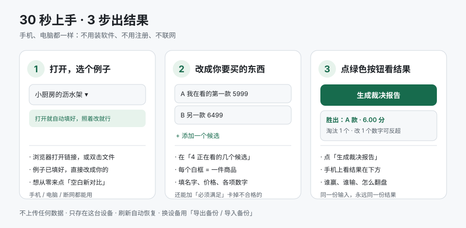

# 一眼看懂 · specpick 怎么用

> **一句话**：把你在看的几个东西、和你在意的条件填进去，它按**你自己写下的标准**告诉你该买哪个，并写清楚「另一个为什么输了」「要改哪个数字它才会赢」。
>
> 不猜你喜欢什么。不用装软件、不用注册、不联网、不用 API Key，手机和电脑都一样。

---

## 先打开它（三选一）

| 你的情况 | 怎么做 |
| --- | --- |
| 手机 / 电脑，有网 | 浏览器打开 **https://cbjinchina.github.io/specpick/**，点开即用，什么都不用装 |
| 没网 / 要发给别人 | 把 **`web/specpick.html`** 这**一个文件**存到手机或电脑，双击打开，完全离线 |
| 想拿截图让模型帮着录参数（进阶） | 电脑上跑 `python playground/server.py 8765`，浏览器开 `http://127.0.0.1:8765` |

打开后**已经有一个填好的例子**（小厨房的沥水架），不用从空白开始，照着改就行。想从零来，点「空白新对比」—— 它给的是一张空表，候选一个也不预置：自己点「+ 添加一个候选」，或者把商品截图直接粘进来。

---

## 三步，30 秒

> **不想读字？点页面顶部那个「开始一步步指引」按钮。** 它会自动跳到该点的地方，用**绿框**圈住、标上序号，底部跟一句话说明这一步干什么；点「下一步 →」继续，点「退出」随时结束。手机、电脑都能用。



### 第 1 步：打开就有例子

页面最上面是个下拉框，已经帮你选好一个例子。左边是**要填的内容**，右边（手机上在下方）是**裁决报告**。

### 第 2 步：改成你要买的东西

> **更省事的走法**：手机相册长按截图 →「提取文字」→ 复制 → 粘到页面「**只有文字？粘文字也能填（备用）**」，**一粘就自动识别**（也可以再点「识别并填入」）。名称和价格自动配好，你只需核对几个数字，不用一个个手打。电脑上更直接：截图后在本页面按 **Ctrl+V（⌘V）**，图片会直接交给识图模型。

> **从空白开始也行**：还没设比较项时直接贴商品截图，它会顺手从图里归纳 2–4 个能比的规格、配好权重并按它们填好；预算要是还留着默认的 ¥1000，也会按图里的价格先调一版并明确提示你改。贴完就能直接出报告。

重点在这里 ——「**4 正在看的几个候选**」就是**填你要对比的物品**的地方：

- **一个白框 = 一件商品**，填名字、价格，以及上面「2 你在意哪些方面」里列的那些数字；
- 商品不够就点「**+ 添加一个候选**」，多了点框右上角的删除；
- 「**1 你要买什么**」第一个框就是写**你要买的东西**（一句话，比如「通勤跑步鞋」「27 寸显示器」），它会成为这次对比的标题；下面还有场景、预算和价格权重；
- 「**2 你在意哪些方面**」拖权重滑块：越在意拖越高，`0` 表示只拿来筛选、不参与打分；
- 每个比较项先选「**怎么比**」—— 8 个选项，其实是四种比法 × 方向，别被「只能按大小排」卡住：
  - **数字 · 越大越好 / 越小越好**：最常见。候选框里**直接贴截图原文**就行 —— `8GB GDDR7`、`跑分 28000`、`1.2万` 都会自动抽出数字，不认识的单位也不影响；
  - **数字 · 越接近目标越好**：会多出三个框，「最舒服 `_` 到 `_`」「偏出 `_` 就不给分」。重量、尺寸、距离、噪音这种**两头都不好**的项用它；上下限填成一样，就是「越接近某个值越好」；
  - **数字 · 按名次**：只看谁比谁强，不看强多少。一个 9000 票的爆款不会把其余候选全压成 0 分；
  - **数字 · 对数刻度**：销量 200 对 12 万这种跨度，按对数比才不至于把小店铺全按到地上；
  - **档位 · 按顺序打分**：给文字排个顺序（例：`差, 一般, 好`，越靠后分越高），候选里变成下拉框。做工、噪音、手感这种只能分档的项用它，文字也能参与打分；
  - **文字 · 只筛选**：不参与打分，只写进硬要求和报告里做说明。
  - 留空 = 「这件没这个数据」。**不会按 0 分算**：缺一项的候选按其余项等比折算；如果一项只有一件候选填了，一个点定不出高低，这项对所有人都不算分，报告里会写明。
- 「**3 必须满足的条件**」写死规矩，比如「宽度 ≤ 30cm」，不合格的会被直接淘汰并写出原因。

想对比电脑？下拉框里就有「**笔记本电脑 · 通勤办公**」这个现成案例，改成你正在看的两三台就行。

### 第 3 步：点绿色的「生成裁决报告」

右边立刻出现：

| 报告里有什么 | 大白话 |
| --- | --- |
| 胜出者 + 总分 | 按你填的权重算出来的第一名 |
| 排名和逐项得分 | 每一分是从哪个比较项来的，不是黑箱 |
| 淘汰理由 | 超预算多少、违反了哪条硬要求，逐条写 |
| 反事实 | 第二名只改**一个**数字，最少改到多少能反超 |
| 敏感性 | 把权重上下拨 25%，这个第一名还稳不稳 |
| 真正决定胜负的项 | 把每个比较项逐个删掉重算：哪几项删掉冠军就换人，哪几项删掉连名次都不变（只占你的注意力） |

手机上报告在表单**下方**，往下划就能看到。

### 第 4 步（可选，但最有价值）：买回来以后再回来说一句

报告下面还有一张卡：**「5 买后回访：过几个月回来记一笔」**。买回来用上一阵，回来填三件事：

| 字段 | 填什么 | 为什么要它 |
| --- | --- | --- |
| 会不会再买 | 会 / 不会 | 算「重来还会买」的比例，这是判断准不准的唯一硬指标 |
| 每周真用几次 | 数字，几乎不用写 0 | 戳破「看着有用」的幻觉 |
| 一句教训 | 例如「被『功能多』带偏了」 | 下次同类购买，权重该往哪调 |

攒够几条，页面会自动汇总：已回访几条、**「重来还会买」比例**、**平均每周使用**，还会单列一条**低频提醒**——买回来基本没用、下次该把权重调到 0 的东西。点「复制复盘 Markdown」能把这份复盘贴进仓库的 `REVIEW.md`；命令行版用 `python -m specpick review` 得到同一份内容。

这些记录只存在本机浏览器，**换例子不会丢**（它属于你的判断档案，不属于某一次对比），「导出备份」会一起带走。

---

## 登录：AI 功能要用手机号验证码

模型调用要求先登录（这是平台规则，不是本站要你的个人信息）。页面顶部有「**登录（手机号验证码）**」：填 11 位手机号 → 点「获取验证码」→ 填短信里的数字 → 点「登录 / 注册」，不设密码。

**不需要 WorkBuddy 账号**。这个登录是本站自己的用户体系，手机号就是账号：没注册过的人第一次登录时自动建号，所以把链接发给朋友、他们谁都能用。登录状态只用来放行 AI 调用；**你填的对比数据仍然只存在本机，不会上传**。不用 AI 功能可以不登录，规则报告照常出。

## 连该比什么都想不到？让 AI 起手

第 1 步卡片里有个虚线框「**不知道该比什么？让 AI 起手**」。填好「1 你要买什么」（比如「通勤跑步鞋」），点一下按钮，它会给出：

- **3–6 个比较项**：每一项都带「为什么值得看」，并且已经选好比法（越大越好 / 越接近目标 / 按档位 / 只看名次）；
- **一两条能一票否决的硬条件**：比如「续航至少 8 小时」；
- **一句取舍建议**，以及这个品类里**最容易踩的坑**。

看完点「**用这套**」，比较项、权重、比法、硬条件会一次性写进表单，你只需把候选的数字填上。不想用就点「**再说一次**」让它换一套；觉得不对直接忽略，表单一个字都不会动。

> 有一点要清楚：**AI 只提方案，不做决定。** 它给的比较项是起点，不是标准答案——你不认同的项可以删、权重可以拖、比法可以改。真正算分、排名、淘汰的仍然是下面那套规则。

## 让 AI 把结论说成人话

报告算出来之后，点报告下方的「**让 AI 说说**」，它会用一段大白话告诉你：该选哪个、为什么、另一个差在哪、要留意什么。它会**逐个字打出来**，嫌慢可以「停一下」，还能「重写」或「复制这段」。

看完还想问？卡片底部有个输入框，直接追问「**B 到底差在哪**」「**要是预算压到 3000 呢**」，它会结合这次的报告数据接着答，问题和回答都留在卡片上，可以连着问几条。

放心：**AI 不会改结论**。谁赢、多少分、多少钱都是纯规则算好的，AI 只做翻译，规定它不许换冠军、不许补事实。数字一律以报告表格为准；你一改数据重算，旧的那段解释就自动收起，免得拿着过期的话去做决定。

> 识图、「让 AI 起手」和「让 AI 说说」都要联网、且**要先登录**（见上一节），只在正式线上地址提供；本地打开的文件和 GitHub Pages 那份只有规则报告，没有这些按钮。

## 手抖了、改乱了、想打出来：四个保险

| 发生了什么 | 页面会怎么反应 | 怎么办 |
| --- | --- | --- |
| 填到一半去接了个电话 | 停止输入约半秒就**自动存好**，标题下方会显示「已保存 22:31」 | 不用点任何按钮，回来自动接着填 |
| 误点「删除」或选错了例子 | 底部弹出一条「…，8 秒内可以撤回」 | 点「撤销」，连改动一起还原；不想要点 × |
| 改了数据但没重新生成 | 报告顶部出现橙色提示「表单改过了，下面还是上一次的结论」 | 点「按新数据重算」，或直接再点一次「生成裁决报告」 |
| 想打印出来、或存成 PDF 带去店里比 | 报告下方有「打印 / 存成 PDF」 | 只印报告那一块，表单、按钮、引导都不会印出来 |

> 为什么要专门做「过期提示」：结论是按你**当时**填的数字算的。改了价格却没重算，屏幕上还挂着旧结论，很容易照着它下单。

---

## 还没想好买什么？按营养倒推

上面整套流程都要求你**手里已经有几件候选**。这张表管的是前一步：**只知道想补点什么，还不知道该买什么**。

它在页面最下面（左边表单底部有个「按营养倒推该买什么 ↓」的入口）。点完会给排序和一份搭配，最下面还有「把前 3 样加成候选」——按一下这几样就填进「4 正在看的几个候选」，补上价格，就回到上面的比价流程里去了。

怎么用：点你想补的营养素（维生素C、膳食纤维、钾、叶酸、钙、铁、维生素A，最多 3 个），选一次吃多少克、在水果还是在全部食物里挑，点「按缺口挑给我」。

出来的是三样东西：

| 看到什么 | 什么意思 |
| --- | --- |
| 排名 + 「补到 74%」 | 不是含量排行榜。按你选的份量算，这一份能补掉几个缺口的加权比例，补到 100% 就不再加分 |
| 「按 30g 算」标签 | 这东西一次别吃那么多（比如猪肝的维A 是日需的 60 倍/100g），算法按上限截断了，不会让你吃 200g 猪肝 |
| 「一份搭配」 | 三样各 100g 凑一份，合计能补到多少；够用就好，超出 100% 的部分算浪费 |
| 「把前 3 样加成候选」 | 一键填回上面「4 正在看的几个候选」，补上价格就能跟别的货一起比，不用重新打字 |
| 橙字提示 | 「铁（这类里最高只有 24%）」= 光靠水果补不上，得换范围或问医生 |
| 控糖 / 限钾 | 含糖 ≥15g/100g、钾 ≥300mg/100g 的会被降权并标出 |

命令行同一份结果：

```bash
python -m specpick nutrition --need vc,fiber
python -m specpick nutrition --need fe,ca --cats all --portion 150
```

⚠️ 数据是每 100g 可食部的常见参考值，**只用于这张表内部的相对比较**，不构成医学建议。真怀疑自己缺什么，看化验单。

---

## 常见问题

**能丢张商品截图进去，让 AI 自动对比吗？**
**能。** 有两种走法，按你在哪用挑：

| 你在哪 | 怎么用 | 说明 |
| --- | --- | --- |
| **线上应用**（`specpick.app.workbuddy.host`） | 点「拍张截图，自动填表」→ 拍照或选图；电脑上直接 **Ctrl+V（⌘V）** 粘贴截图 | 云端多模态模型直接读图，**你不用申请任何 Key**；只读名称和参数，不打分不推荐。图片只用于这次识别 |
| **手机系统识别的文字** | 相册长按截图「提取文字」→ 复制 → 粘到「只有文字？粘文字也能填（备用）」 | 完全离线，零依赖，认不出的留空；**粘完自动开始识别**，不用再点按钮 |

**为什么 GitHub Pages 那份没有拍照识别**：云端接口会校验页面来源（Origin），只有发布到应用域名才放行。GitHub Pages 和离线的单文件版就用「粘文字」这条路，功能一样，只是少了自动读图。

**还没设比较项，贴图有用吗**：有用。它会从图里同类商品都在标的规格中挑 2–4 项（比如显存、功耗）设成比较项并填好，你只调权重。它只归纳图里真实出现的参数，图上没有的不会硬凑。

**认不出的怎么办**：留空，并提示你「还有 N 个数字是 0」。它不猜——价格读错一位，整份裁决就反了。

（**进阶**：电脑上的本地测试台还支持把截图交给对话侧模型读成参数、写回 TOML，再人工核对。模型只做录入，不打分、不下结论、不写报告。）

**例子里的价格是真的吗？**
分三种，看下拉框下面那行小字就能认出：

| 例子 | 价格来源 | 能不能当报价用 |
| --- | --- | --- |
| **显卡 · 京东截图** | **真实**：2026-11-11 一张京东「RTX 5060」搜索结果页截图，取卡片上的**列表标价**；每件都带「数据来源（`source`）」字段，写着「第几行第几列 · 哪家店」 | 是那一刻的标价，之后会变 |
| **笔记本电脑** | **示意值（虚构）**：机型名是泛化的（「14 寸轻薄办公本」），价格是编的，只用来演示流程 | 不能 |
| **厨房沥水架** | 自填示例，参数是 1–5 的**主观评分** | 不能 |

你自己新建的对比，价格当然以你填的为准——工具不会替你去查，也不假装知道。

**我填的东西会上传吗？**
对比数据不会。只存在这台设备的浏览器里，项目没有数据库。手机号登录只用于放行 AI 调用，账号里不存你的候选和价格；只有你主动点 AI 按钮时，那一次要分析的内容才会发给模型。
**边填边自动保存**：停止输入约半秒就落盘，刷新、关掉再打开都会自动恢复（标题下方会显示「已保存 22:31」）。

**换手机 / 换电脑怎么办？**
在原设备点「**导出备份**」存一个 `.json`，到新设备点「**导入备份**」选它。

**结果靠谱吗？会不会每次不一样？**
同样的输入永远得到同样的输出：没有随机数、没有模型。网页版和命令行版是同一套算法的两个实现，CI 每次用 3 个真实案例 + 7 个边界案例逐字段交叉比对，任一边改了算法没同步，构建直接失败。

**能存档、能对比「三个月前我怎么想的」吗？**
点「**查看 / 复制 TOML**」，两段文本存成 `needs.toml` / `items.toml` 就能 `git diff`。命令行版跑出来是同样的裁决，还能用 `records/` 记录买回来之后到底后不后悔。见 [README](README.md)。

**词看不懂？**

| 词 | 意思 |
| --- | --- |
| 权重 | 这个方面对你有多重要，数字越大越重要 |
| 硬要求 | 一票否决的条件，不满足直接出局 |
| 反事实 | 「要是它便宜 300 块，是不是就赢了」这类问题的精确答案 |
| 敏感性 | 结论对权重变化有多敏感，稳 / 脆弱 |
| source（数据来源） | 这个数字是从哪来的，比如「第 2 行第 3 列 · 某店」；写清出处，错了才查得到 |

---
**问：权重滑块拖不准怎么办？**
答：先按感觉拖，别求准。报告里的「敏感性」和「真正决定胜负的项」会告诉你哪几项其实不影响结论——把那几项设成 0，只在真正决定胜负的两三项上认真调，比一开始就纠结全部数字准得多。

**问：报告里说「这几项删掉冠军就换人」，是什么意思？**
答：系统把每个比较项逐个拿掉重算了一遍。删掉某项冠军就变 → 这项在真正决定结果；删掉某项连名次顺序都不变 → 它只占你的注意力，不改变结论，权重可以往下压或干脆删掉。

**问：为什么不能一律「越大越好」？**
答：因为很多项不是越大越好。重量、尺寸、离家的距离、风扇噪音都是「中间最舒服、两头都难受」，拿「越大越好」去比，等于在奖励最重的那件。选「**越接近目标**」并填上最舒服的区间，才不会把方向搞反。

**问：销量 200 和 12 万放一起，小卖家直接 0 分，合理吗？**
答：不合理，所以有「**对数刻度**」。线性比法下 200 分只能拿 0.0016，等于判死刑；对数刻度把它抬到五成左右，还保留「越多越好」的顺序。评价数、粉丝数、下载量这类跨度大的都适用。

**问：一个爆款把其他候选全打成 0 分怎么办？**
答：换成「**按名次**」。它只认谁比谁强，第一名满分、最后一名 0 分，中间按名次排。9000 票和 41 票之间的差距不再放大成 0 和 1，而是「第 1 名和第 2 名」。


## 进阶：命令行（给爱折腾的人）

需要 Python ≥ 3.11，不需要 `pip install`：

```bash
python -m specpick check examples/kitchen-rack      # 检查填得对不对
python -m specpick decide examples/kitchen-rack     # 生成 report.md
python -m specpick review --records records --out REVIEW.md   # 买后回测
python -m unittest discover -s tests -v            # 跑测试
```

完整设计、输入格式、图片辅助录入的边界和「刻意不做」的清单都在 [README](README.md)。
